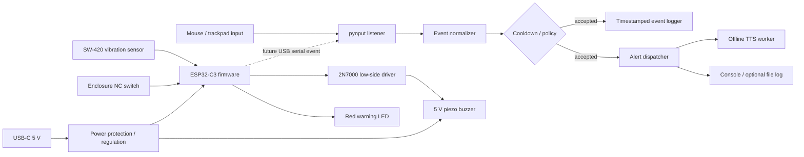

# Mouse Tamper Monitor — System Design

## 1. Design intent

Mouse Tamper Monitor protects an unattended computer by treating unexpected pointer activity as a tamper event. The first implementation is a lightweight Python process that listens for global mouse clicks and scrolls, records an event, and announces an alert through offline text-to-speech. The repository also contains the beginning of a USB-powered ESP32 hardware companion that can detect physical movement or enclosure opening and drive a local buzzer and warning LED.

The recommended product design is a **two-layer monitor**:

1. **Host monitor:** detects logical mouse activity on the operating system.
2. **Hardware monitor:** detects movement or enclosure tampering even when the host software is bypassed, muted, or not running.

The two layers should be useful independently, but the hardware layer should be able to signal the host over USB in a later integration step.

## 2. Current implementation assessment

### Working today

- `secure_monitor.py` uses `pynput.mouse.Listener` to receive global click and scroll events.
- Mouse button release events are ignored; only button presses create alerts.
- A global cooldown (`ALERT_COOLDOWN`, currently 3 seconds) suppresses repeated alerts.
- Alert text is printed with millisecond timestamps.
- Speech is queued to a dedicated worker thread so the mouse callback is not blocked by `pyttsx3`.
- The worker initializes Windows COM when available and exits on a sentinel message.
- Ctrl+C stops the listener and requests speech-worker shutdown.

### Gaps to resolve before calling the project production-ready

- The README describes a 10-second cooldown, while the current Python source uses 3 seconds.
- The README says `pynput` is the only dependency, but the current source also requires `pyttsx3` and commonly `pywin32` on Windows.
- The repository does not contain ESP32 firmware. The Python script cannot read the proposed GPIO inputs or drive the proposed buzzer/LED.
- The KiCad artifacts are not yet fabrication-ready: the `.kicad_sch` file is only a minimal container, and the file named `.kicad_pcb` contains legacy schematic text. These should be regenerated and checked in KiCad before ordering a board.
- The journal and project notes specify SW-420 and an enclosure NC switch, but the listed BOM does not include either sensor as a distinct component.
- There is no persistent event log, configuration file, service/auto-start path, test suite, or health indicator.

## 3. Proposed architecture



### Runtime responsibilities

**Input layer.** The desktop listener receives click and scroll callbacks. A future hardware adapter can receive newline-delimited serial messages such as `VIBRATION` and `ENCLOSURE_OPEN` without changing the alert policy.

**Normalization layer.** Every raw input becomes a common event object:

```text
TamperEvent {
  source: host_mouse | vibration | enclosure_switch,
  kind: left_click | right_click | middle_click | scroll | vibration | enclosure_open,
  timestamp: ISO-8601 local time,
  position: optional (x, y),
  details: optional text
}
```

**Policy layer.** The policy decides whether an event is actionable. It should support a configurable cooldown, an optional arming delay, and an explicit test mode. The current project uses one global cooldown; the next version should make this a command-line or configuration setting.

**Alert layer.** Accepted events are sent to one or more sinks: console output, offline speech, local hardware buzzer/LED, and a durable event log. Sinks must fail independently. For example, a missing audio device must not stop input monitoring.

## 4. User experience and states

The monitor should have five visible states:

- **Disarmed:** listeners are stopped and no alerts are generated.
- **Arming:** a short countdown gives the owner time to leave the workstation.
- **Armed:** the system watches for host and hardware tamper events.
- **Alerting:** an event has been accepted; the system logs it, speaks a warning, and activates local outputs.
- **Fault:** a required listener or hardware connection failed. The process should show the failed channel and continue monitoring any healthy channels.

Recommended operator messages:

```text
[INFO] Arming in 10 seconds. Move away from the workstation.
[INFO] Monitor armed. Host mouse + hardware sensors active.
[ALERT] 2026-11-14T16:25:02.337+04:00 source=host_mouse kind=left_click x=842 y=619
[ALERT] Enclosure opened; local alarm active.
[WARN] Hardware serial channel disconnected; host monitoring continues.
```

The alert should be visually obvious but not depend on a GUI. The initial CLI is appropriate for the prototype. A small tray application can be added later for arm/disarm, current state, cooldown, and recent events.

## 5. Desktop software design

Refactor `secure_monitor.py` into small testable modules:

```text
mouse_tamper_monitor/
  __main__.py          # CLI entry point
  config.py            # defaults and environment/CLI parsing
  events.py            # TamperEvent and event normalization
  sources/
    mouse.py           # pynput adapter
    serial.py          # optional ESP32 adapter
  policy.py            # arming state and cooldown rules
  alerts/
    console.py         # stdout formatter
    speech.py          # single long-lived TTS worker
    file_log.py        # JSONL or CSV append-only log
  tests/
```

The existing single speech worker is the right concurrency model. It should use a bounded queue and expose a clean `stop()` method. A full queue should coalesce or drop repeated low-value alerts rather than allowing unbounded memory growth. TTS initialization failure should mark only the speech sink unhealthy.

Recommended CLI surface:

```text
python -m mouse_tamper_monitor --cooldown 3 --arm-delay 10
python -m mouse_tamper_monitor --no-speech --log events.jsonl
python -m mouse_tamper_monitor --serial COM5
python -m mouse_tamper_monitor --test-alert
```

Use monotonic time for cooldown calculations and wall-clock time only for log timestamps. This avoids incorrect behavior when the system clock changes.

## 6. Hardware design

### Power path

USB-C VBUS provides nominal 5 V. The regulated 3.3 V rail powers the ESP32-C3 and 3.3 V sensors. The buzzer uses the 5 V rail and is switched on the low side by a 2N7000. Place input and output capacitors close to the regulator and add local 100 nF bypassing at the ESP32 and sensor supply pins.

The final schematic must include the USB-C device pull-down resistors on CC1 and CC2, confirm the exact ESP32-C3-MINI-1 footprint and pin numbering, and verify regulator dissipation at the worst-case buzzer and sensor load. The proposed AMS1117 is acceptable for a prototype only after thermal and stability checks; a lower-dropout regulator is preferable for production.

### Inputs

- **SW-420 digital vibration sensor:** connect digital output to ESP32 GPIO4 (`VIBRATION`). Debounce in firmware and require a short persistence window to reject noise.
- **Normally closed enclosure switch:** connect to GPIO5 (`TAMPER_NC`) with a pull-up. Treat an open circuit as tamper, including a disconnected wire.

### Outputs

- **Buzzer:** GPIO6 (`BUZZER_EN`) drives the 2N7000 gate through an appropriate gate resistor. Buzzer positive connects to +5 V; buzzer negative connects to the MOSFET drain. Confirm whether the selected buzzer is genuinely piezoelectric; add suppression if the actual load is inductive.
- **Warning LED:** GPIO7 (`LED_WARN`) drives the red LED through 330 ohms. Use a known LED forward voltage and verify current at 3.3 V.

### Firmware behavior

The ESP32 firmware should boot into disarmed state, run a short self-test, and then wait for an arm command or a local arm input. When armed:

1. Sample the vibration input with debounce and a minimum event interval.
2. Fail safe on an enclosure switch opening or sensor wire fault.
3. Activate LED and buzzer using a bounded alarm pattern.
4. Emit a machine-readable USB serial event.
5. Keep the alarm active until a local reset/disarm action is received, or until a configured timeout.

## 7. Event and alert policy

The default policy should be conservative:

- Any accepted left, right, middle, or scroll event is a tamper event.
- Host events are rate-limited globally to prevent callback storms.
- Enclosure opening is high severity and should bypass the normal host cooldown.
- Vibration events require debounce and a short persistence threshold.
- Every accepted event is logged, even when speech is disabled or the sound device is unavailable.
- The first event after arming should include the source and event kind in the spoken message.

Suggested severity levels:

```text
INFO  - armed, disarmed, self-test, channel connected
WARN  - noisy vibration, speech unavailable, serial disconnected
ALERT - mouse click, scroll, enclosure open, confirmed vibration
FAULT - listener cannot start, invalid hardware configuration
```

## 8. Validation plan

### Desktop tests

- Unit-test normalization for each mouse button, scroll direction, and ignored release event.
- Verify that cooldown uses monotonic time and suppresses only events inside the configured window.
- Replace the real TTS engine with a fake sink in tests and verify FIFO ordering.
- Test Ctrl+C and worker shutdown without leaving a listener or thread alive.
- Test behavior when `pyttsx3`, `pywin32`, or an audio output device is unavailable.
- Confirm JSONL/CSV log records remain parseable after abrupt process termination.

### Hardware tests

- Run KiCad ERC and DRC after regenerating real schematic and PCB files.
- Verify USB-C CC resistors, ESD/power protection, regulator capacitors, ground return, and ESP32 antenna keep-out.
- Test the 5 V buzzer current and MOSFET temperature under continuous alarm.
- Open the enclosure switch and disconnect its wire; both must create tamper events.
- Tap the enclosure repeatedly and confirm vibration debounce prevents alert storms.
- Unplug and reconnect USB power and confirm a deterministic boot state.

### End-to-end tests

- Arm the system, click and scroll, and verify one console record, one speech message, and one hardware indication per accepted event.
- Disconnect the hardware serial link and verify host monitoring continues with a warning.
- Disable the audio sink and verify local LED/buzzer and persistent logs continue.
- Attempt to stop the process and document that this prototype cannot protect against a user with operating-system privileges.

## 9. Repository changes recommended

The next implementation pass should add:

```text
pyproject.toml or requirements.txt
mouse_tamper_monitor/      # modular package
tests/                     # unit and integration tests
firmware/                  # ESP32-C3 source and build instructions
hardware/                   # regenerated KiCad project and fabrication outputs
config.example.toml        # documented defaults
CHANGELOG.md
```

The two BOM files should be consolidated into one authoritative BOM with reference designators, exact part numbers, sensor entries, and a generated total. The README should link to this design, state the actual cooldown, list all runtime dependencies, and clearly label the hardware as prototype status until the KiCad project passes ERC/DRC.

## 10. Definition of done

The project is ready for a first physical prototype when the desktop package has automated tests, the ESP32 firmware can emit and locally indicate tamper events, the KiCad schematic and PCB are real editable source files, the BOM matches the schematic, and a complete end-to-end test confirms that host mouse tampering and physical enclosure tampering both produce timestamped alerts.
